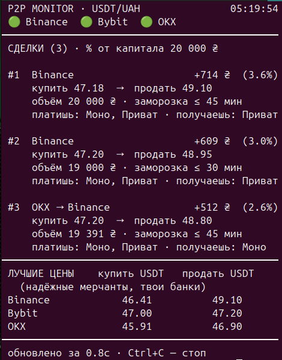

# P2P Monitor

> Монитор P2P-арбитража USDT/UAH на Binance, Bybit и OKX в реальном времени.
> Real-time P2P arbitrage monitor (USDT/UAH) across Binance, Bybit and OKX.

**Стек:** Python · asyncio / aiohttp · 3 биржевых API · SQLite · Telegram-бот · pytest (19 тестов)



## Назначение
Консольный монитор P2P USDT/UAH на **Binance, Bybit, OKX**. Получает объявления, приводит их к общей модели,
ищет потенциальный арбитраж (внутри биржи и между биржами), пишет историю в SQLite и может слать сигналы в Telegram.

**Сигнал ≠ прибыль.** Перед сделкой проверь условия объявления (требования мерчанта, "только первая особа",
ФОП, время оплаты), лимиты банков, комиссии вывода и риск блокировки карты.

## Архитектура
`ExchangeAdapter (x3) -> Advertisement -> find_opportunities -> signal filters -> terminal / SQLite / Telegram`

## Файлы
- `app/models.py` — единая модель объявления (`payment_keys` — нормализованные банки, `is_fixed_amount`).
- `app/payments.py` — нормализация банков: `Monobank (Card)` / `Monobank (IBAN)` / `Monobank` → `monobank`.
- `app/http.py` — общий HTTP с ретраями (сетевые ошибки, 429, 5xx) и backoff.
- `app/exchanges/base.py` — интерфейс адаптеров + кеш/троттлинг (`min_interval`).
- `app/exchanges/binance.py` — Binance P2P (публичный bapi endpoint).
- `app/exchanges/bybit.py` — Bybit P2P (публичный endpoint сайта `api2.bybit.com/fiat/otc/item/online`, без ключа).
  Справочник банков грузится ~11 с, кешируется в `cache/bybit_payments.json` на сутки.
- `app/exchanges/okx.py` — OKX P2P (публичный endpoint сайта `okx.com/v3/c2c/tradingOrders/books`, без ключа).
- `app/analyzer/arbitrage.py` — спред, объём, комиссии, перевод между биржами, safety buffer, score.
- `app/storage/sqlite.py` — история сигналов (first_seen / last_seen / seen_count — сколько живёт связка) и лучшие цены.
- `app/alerts/telegram.py` — алерты в Telegram с cooldown.
- `app/terminal.py` — вывод в консоль. `app/main.py` — основной цикл.
- `config.yaml` — все настройки. `.env` — секреты (git-ignored, шаблон `.env.example`).

Эндпоинты Bybit/OKX — неофициальные (те, что использует сайт). Могут поменяться без предупреждения:
если биржа стала OFFLINE — смотри `p2p-monitor.log`.

## Соглашение side
Side = сторона **мерчанта**: `SELL` — мерчант продаёт USDT → мы покупаем; `BUY` — мерчант покупает → мы продаём.

## Арбитраж
1. Фильтр качества: completion rate, число ордеров, макс. время оплаты (`max_pay_time_minutes`).
2. Оплата: если задан `my_payment_methods` — каждая нога должна поддерживать один из твоих банков
   (можно платить Моно, а получать на Приват). Если пусто — нужен общий банк у обоих объявлений.
3. Объём в USDT ограничен доступным количеством и лимитами обеих сторон; фиксированные объявления (min == max)
   проходят только если сумма влезает во вторую ногу.
4. Межбиржевая связка: из проданного объёма вычитается `transfer_fee_usdt`.
5. Комиссии, safety buffer → realistic profit.
6. Score (0–100): прибыль, completion rate, ликвидность, история ордеров, скорость (время на оплату).
   `LOCK-UP` — сколько максимум заморожены деньги (сумма лимитов оплаты двух ног).

## Запуск
```bash
cd ~/p2p-monitor
.venv/bin/pip install -r requirements.txt
.venv/bin/python run.py          # live
.venv/bin/python run.py --once   # один проход
.venv/bin/python -m pytest -q    # тесты
```

## Telegram
1. Создай бота у @BotFather, узнай свой chat id (например, через @userinfobot).
2. `cp .env.example .env` и заполни `TELEGRAM_BOT_TOKEN`, `TELEGRAM_CHAT_ID`.
3. В `config.yaml`: `alerts: telegram: true`.

## История (SQLite)
```bash
sqlite3 p2p.db "SELECT buy_exchange, sell_exchange, round(best_profit_percent,2), seen_count, first_seen, last_seen FROM signals ORDER BY last_seen DESC LIMIT 20;"
```

## Дальнейший план
- Учитывать условия из текста объявления (remark): "только первая особа", ФОП, новые аккаунты.
- Реальные комиссии вывода по сетям вместо одного `transfer_fee_usdt`.
- Статистика по истории: сколько живёт сигнал, в какие часы чаще.
